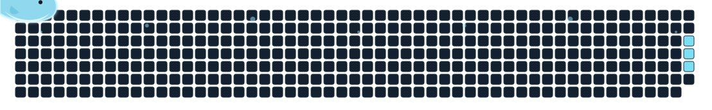

  

<h1 align="center">luck9420</h1>

  

  <code>AI 应用</code> · <code>产品</code> · <code>手搓小工具</code> · <code>会动的小系统</code>

---

### 关于我

- 白天在折腾 AI 与产品，晚上补课、画画、改自己的小玩意。
- 喜欢银紫色的夜、龙、鲸鱼，和“按下按钮就自己跑起来”的东西。
- 相信**能回查的结论**比漂亮的总结更值钱。

### 在忙的事

| 项目 | 一句话 |
| --- | --- |
| [meeting-to-action](https://github.com/LinJJ12/meeting-to-action) | 把会议逐字稿变成有据可查的纪要：每条结论都能指回原话。 |
| 手搓工具（未公开） | 记忆索引、本地评测流水线、每日自动出片，都是自己写给自己的。 |

### 它每天替我游一遍

  

绿格子是记录，蓝格子也是。鲸鱼游过去的时候，顺手数一遍。

  
   
  本页由我和小袖一起维护 · 2026

