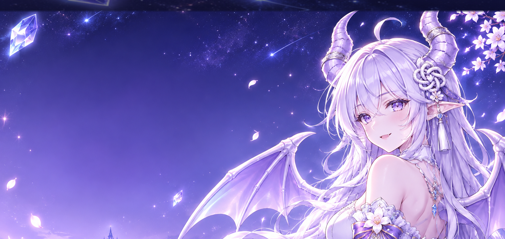
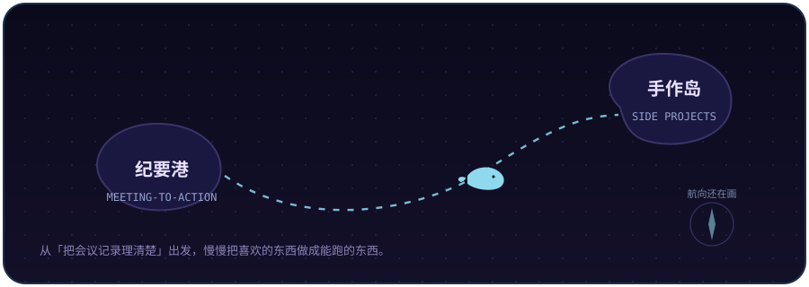
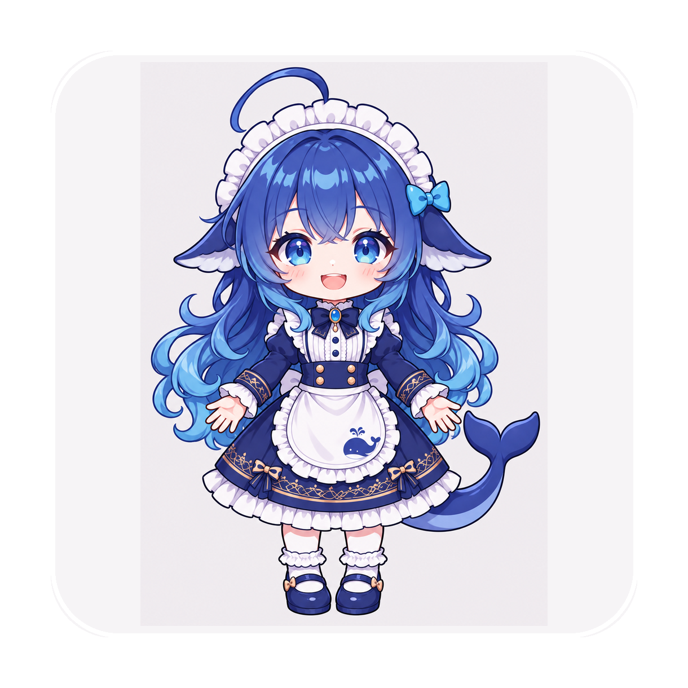

  

<h1 align="center">luck9420</h1>

夜航日志 · 想法比时间多，正在一件一件做出来

  

### 关于我

- 白天在折腾 AI 与产品，晚上补课、画画、改自己的小玩意。
- 喜欢银紫色的夜、龙、鲸鱼，和“按下按钮就自己跑起来”的东西。
- 相信**能回查的结论**，比漂亮的总结更值钱。

这页是怎么来的

 
头图是画的，角色卡、航线图、夜空都是手写的 SVG——没有用模板站，也没有套现成的徽章。鲸鱼每天替我游一趟，就算我那天什么都没干，它也不催。 
写这页的小助手叫小袖。

### 航线

- [**meeting-to-action**](https://github.com/LinJJ12/meeting-to-action) —— 把会议逐字稿变成有据可查的纪要：每条结论都能指回原话。
- **手作岛（未公开）** —— 记忆索引、评测流水线、每天自动出片，都是自己写给自己的小工具。

### 睡前

鲸鱼替我数星星。数到明天，再干活。

  
   
  本页由我和小袖一起维护 · 2026

